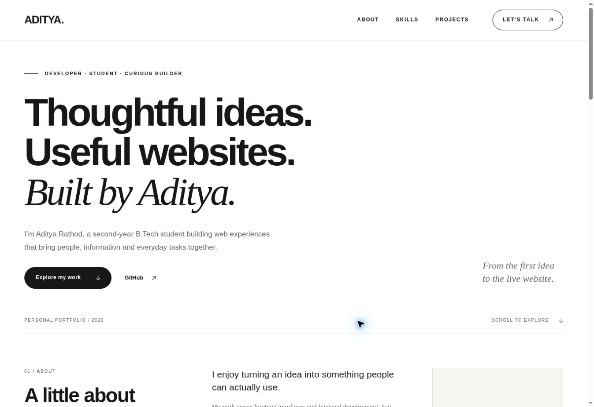

# Aditya Rathod Portfolio

A minimal personal portfolio built with HTML, CSS and JavaScript for the Web Technology portfolio project. It introduces Aditya Rathod, presents skills and showcases three independently created projects.

## Technologies

- HTML5 for semantic page structure and the contact form.
- CSS3 for typography, layouts, hover effects and responsive media queries.
- JavaScript for mobile navigation, contact-form validation and the current footer year.
- System fonts: Arial/Helvetica and Georgia. No font downloads, framework or build dependencies are required.

The Python, Django, databases and AWS listed on the website are Aditya's broader project skills; this portfolio itself is a static HTML/CSS/JavaScript website.

## Features

- About, Skills, Projects and Contact sections.
- Three project screenshots with live website and GitHub links.
- Responsive desktop, tablet and mobile layouts.
- Mobile navigation with expanded-state labels, Escape handling and automatic closing after link selection.
- Contact form with required-field, email and minimum-message-length validation.
- FormSubmit integration for email forwarding to rathodaditya2341@gmail.com, with spam protection and a honeypot.
- Direct email, LinkedIn and GitHub contact links.
- Keyboard focus indicators, a skip link, descriptive image text and reduced-motion support.
- Empty profile-photo space, ready for a personal image.

## Run locally

Open `dist/index.html` in a browser. For the flat downloadable package, open `index.html` instead.

No installation or build step is needed. To test email submission, use the hosted website or a local HTTP server; submission from a `file://` page is not supported. Run `python -m http.server 8000 --directory dist` from this repository and visit `http://localhost:8000`. For the flat ZIP folder, omit `--directory dist`.

## File structure

The hosting repository keeps the website in `dist/`. The downloadable package places these website files directly in its main folder:

- `index.html` — content and structure.
- `style.css` — all styling and responsive rules.
- `script.js` — interactions and validation.
- `images/` — project images and portfolio screenshot.
- `README.md` — project overview and setup instructions.

## Add a profile photo

1. Save the photograph as `images/profile.jpg` next to the other website images.
2. In `index.html`, find the element `

`.
3. Replace that element with ``.

The existing `.portrait img` CSS handles its size and crop.

## Contact form behaviour

The form validates the visitor's name, email and message, then makes a normal HTTPS POST to FormSubmit. FormSubmit processes those details, handles its spam check and forwards the message to `rathodaditya2341@gmail.com`. The visitor's email is included so Aditya can reply. The page tells visitors that this service processes their information.

### One-time activation

1. Open the hosted portfolio and submit a test message with your own name and email.
2. Complete FormSubmit's spam check if shown.
3. Open the activation email in `rathodaditya2341@gmail.com` and confirm the form. Check Spam if needed.
4. Submit another test and verify that the message arrives.

FormSubmit requires email confirmation before normal forwarding works. No delivery has been verified until activation and a received-message check are completed. Keep reCAPTCHA enabled. No Gmail password or application password is required. FormSubmit displays its own confirmation/result page; the portfolio does not claim delivery before the provider responds.

After changing the site's domain or recipient email, retest and complete any new activation requested by the provider. FormSubmit may retain submissions according to its own policy; see https://formsubmit.co/documentation and https://formsubmit.co/help.

## Featured projects

| Project | Website | Repository |
| --- | --- | --- |
| Tech Web | https://techweb-alpha.vercel.app/ | https://github.com/rathod2341/tech-web-app |
| Nova Care | https://novacare-five.vercel.app/ | https://github.com/rathod2341/novacare |
| Home Hive | https://society-django.vercel.app/ | https://github.com/rathod2341/society-django |

Project language labels are based on the supplied GitHub language screenshots. These screenshots do not establish every framework, database or hosting service used by an individual project.

## Checks

- JavaScript syntax checked with `node --check dist/script.js`.
- Desktop browser review of the homepage and project layout.
- Empty contact form rejected with individual field errors.
- Form action, POST method, required input names and validation checked for the email integration.
- Activation and actual inbox delivery require the owner's confirmation and test; they have not been verified.
- Responsive breakpoints are included at 1050px and 700px; review on your own phone before submission.

## Assessment and GitHub

Use a public GitHub repository named `Rathod_Aditya_267933_Portfolio`. Keep meaningful development commits as you work; a final ZIP upload alone does not preserve a Git commit history. The download includes a Git bundle as a separate backup of the development history, with restoration instructions.

The three project repository links above are examples of previous work. They are not the repository link for this new portfolio. Add the new portfolio repository URL to the assignment PDF title page and submission email once it exists.

## Credits

Content and project screenshots supplied by Aditya Rathod. Visual direction based on the reference website supplied by the user. Portfolio implementation prepared with ChatGPT assistance; review, understand and personalise it in line with your course requirements.
